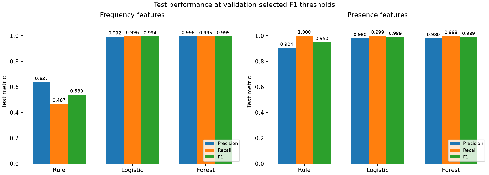
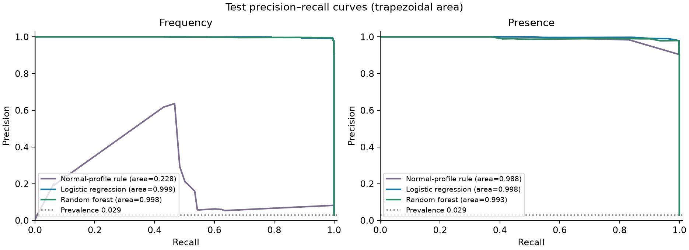

# HDFS Log Anomaly Detection

## Project Overview

**Detecting Anomalous Events in Distributed System Logs Using Machine Learning: A Comparative Evaluation on HDFS_v1**

A completed, reproducible research-training benchmark for Dezhang Li's Computer Science Research Portfolio: three methods × two feature representations, tested on all 575,061 eligible HDFS_v1 blocks. The project demonstrates data validation, controlled model evaluation and honest interpretation of a highly repetitive benchmark. It proposes no new algorithm and is not a published paper or production detector.

Read the [English Research Report](report/RESEARCH_REPORT.md) (~2,700 words excluding tables/references) and the [fixed experiment protocol](docs/EXPERIMENT_PROTOCOL.md).

## Research Questions

1. How do a simple rule, Logistic Regression and Random Forest compare in precision, recall and F1?
2. At a validation FPR target of ≤1%, do learned models recover more anomalies?
3. How do event frequency and binary event presence affect performance?

## Dataset

[Loghub HDFS_v1](https://github.com/logpai/loghub/tree/master/HDFS), from [Zenodo record 8196385](https://zenodo.org/records/8196385). The official ZIP is **186,645,559 bytes**; its MD5 matches the publisher, and SHA-256 is `04f919f2185821f23f045dca611a7586429bdabc601bd7b43f30005f8e289b01`. See the [actual file manifest](data/manifest.json), [archive inventory](data/archive_inventory.json), [acquisition instructions](data/README.md) and [licence notice](data/LOGHUB_LICENSE.txt).

Four preprocessed files were extracted; the 1.58 GB raw log remains compressed. The CSVs contain **558,223 Normal and 16,838 Anomaly blocks (2.9280%)** with 29 event features. Every label is joined by Block ID, and every trace's event counts match its matrix row. `Label`, `Type` and `BlockId` are excluded from predictors. The object-valued official NPZ is not unpickled or used for modeling. These are benchmark system-anomaly labels, not network-attack truth.

The dataset licence permits research/academic use with attribution and retention of the notice. Raw data are not included in Git. Record version v8 is not a different HDFS dataset version.

## Methods

- **Rule:** maximum standardized marginal deviation from normal-training feature means; SD floor of one.
- **Logistic Regression:** balanced weights, C=1; frequency log1p and training-only scaling.
- **Random Forest:** 100 trees, depth 12, minimum leaf size 5, balanced-subsample weights.

All use the same stratified, ID-disjoint split: **345,036 train / 115,012 validation / 115,013 test**, seed 20261021. The 30,000-block pilot used only the final training pool. All six final threshold pairs were frozen on validation before test scoring; no hyperparameter search or test-driven tuning was performed. Anomaly is positive. PR-AUC below means trapezoidal area; [full results](results/final-20261021/metrics.csv) also contain average precision, confusion counts and FPR.

## Key Results

Test metrics at validation-selected F1 thresholds:

| Features | Method | Precision | Recall | F1 | PR-AUC |
|---|---|---:|---:|---:|---:|
| frequency | rule | 0.6366 | 0.4670 | 0.5388 | 0.2277 |
| frequency | logistic | 0.9923 | 0.9961 | 0.9942 | 0.9987 |
| frequency | forest | 0.9955 | 0.9947 | 0.9951 | 0.9983 |
| presence | rule | 0.9039 | 1.0000 | 0.9495 | 0.9876 |
| presence | logistic | 0.9799 | 0.9988 | 0.9893 | 0.9976 |
| presence | forest | 0.9799 | 0.9976 | 0.9887 | 0.9925 |


The learned frequency models outperform the frequency rule. However, the **presence rule already reaches 100% recall at test FPR 0.3207%** (358 false positives). Under the validation FPR ≤1% constraint, learned models do not universally improve recall over that rule. See [validation metrics](results/final-20261021/validation_metrics.csv) and [error patterns](results/final-20261021/error_patterns.csv).

**High-score caveat:** only 589 unique frequency vectors and 119 presence vectors occur across the entire dataset. 99.9400% of test blocks share a frequency vector with training. This evaluates familiar-pattern classification within one environment; it does not establish unseen-failure, temporal or cross-system generalization.





Additional figures: [workflow](figures/final-20261021/workflow.png), [confusion matrices](figures/final-20261021/confusion_matrices.png), [constrained FPR comparison](figures/final-20261021/fpr_operating_point.png).

## How to Reproduce

Verified on **macOS 27.0.1 arm64, Python 3.13.2**, using a fresh local virtual environment. Other platforms have not been tested. No forensic utilities or unknown dataset code are executed. Allow at least 3 GB free disk space and a network connection for the official data/dependency downloads.

From this P3 directory:

```bash
python3 -m venv .venv
source .venv/bin/activate
python -m pip install -r requirements.txt
python scripts/acquire.py
python scripts/prepare.py
python -m unittest discover -s tests -v
python scripts/run.py --mode pilot --run-id pilot-local
python scripts/evaluate.py --run-id pilot-local
python scripts/run.py --mode final --run-id final-local
python scripts/evaluate.py --run-id final-local
```

`run.py` requires a **new run ID** and refuses to overwrite prior runs. Run IDs `pilot-20261021`, `final-20261021` and `reproduction-20261021` already exist in this checkout; use the new IDs above or another unused name. Acquisition verifies existing originals without downloading again. Preparation rebuilds local derived arrays and diagnostics. If a download is interrupted, inspect the retained `.part` file as described in data/README.md before retrying.

To repeat scoring without retraining:

```bash
python scripts/evaluate.py --run-id final-local
```

This regenerates tables/figures from saved predictions and asserts agreement with the first exported metrics. Local predictions are regenerated by training and are deliberately excluded from Git; a fresh checkout must run the pipeline before rescoring. To compare the new run against the saved benchmark:

```bash
python scripts/verify.py --compare final-local
```

The same commands were executed with the archived run IDs above. Eleven unit tests passed. Complete retraining reproduced all reported metrics; full prediction rescoring and figure regeneration also passed. Forest floating-point scores differed by at most 1.11e-16 between runs, without changing reported metrics. Do not interpret machine-level score identity as a cross-platform guarantee. [Verification record](results/final-20261021/reproduction.json).

## Repository Structure

```text
src/hdfs_study/    Keyed merging, splitting, rule and scoring
scripts/          Acquisition, preparation, fitting, evaluation, verification
tests/            Unit tests
data/             Source manifest and licence; raw/processed/interim ignored
results/data/     Actual counts, duplicate diagnostics and data quality
results/pilot-20261021/          Training-pool pilot only
results/final-20261021/          Main tables, diagnostics and logs
results/reproduction-20261021/   Independent same-platform rerun
figures/          CSV-generated plots, separated by run
report/           English report and short implementation notes
requirements.txt  Exact environment versions
```

## Limitations

- Block IDs are disjoint, but raw-line sharing between blocks was not reconstructed or isolated.
- Publisher preprocessing uses an upstream event vocabulary; this is not train-only parser evaluation.
- Repeated vectors dominate all splits; some identical representations have conflicting labels. [Diagnostics](results/data/duplicate_vectors.csv).
- Only 69 test blocks have unseen frequency patterns, and only 13 have unseen presence patterns; the latter are all anomalous, making subset FPR undefined. [Subset metrics](results/final-20261021/seen_unseen_metrics.csv).
- One environment and one random split; no independent-incident confidence intervals, temporal holdout, deployment evaluation or attack-detection claim.
- Supervised methods and the normal-only rule have different training information. This is a descriptive comparison of specified configurations.
- Final release and researcher review remain pending. Historical unsigned gates are retained as history and superseded by the user's lightweight workflow; no prior approval is fabricated.

## References

See the report's eight [references](report/RESEARCH_REPORT.md#8-references), including Xu et al. (SOSP 2009), He et al. (ISSRE 2016), Zhu et al. (ISSRE 2023), Jiang et al. (ISSTA 2024), Landauer et al. (2023), Le and Zhang (2022), Breiman (2001), and scikit-learn metric documentation. The newer Loghub-2.0 parsing paper is cited as requested by the source repository; Loghub-2.0 is not the dataset evaluated here.

## AI Assistance Disclosure

Codex assisted with research-source checks, coding, debugging, execution, visualization and report drafting. Results come from actual runs. The project does not represent the work as independently hand-coded or already scientifically reviewed by the student. The student should understand and review it before using it in an application. P1/P2/P4/P5 were kept unchanged; no remote repository was created or pushed.
