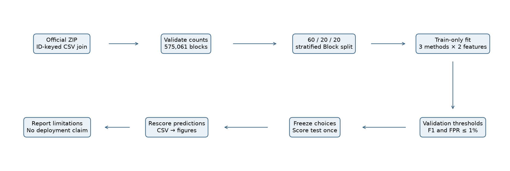
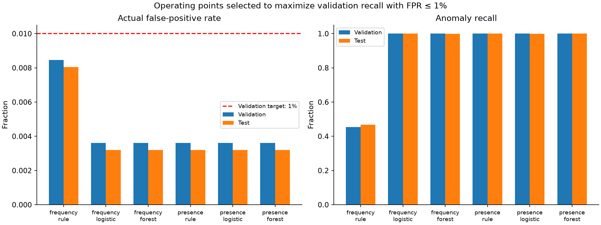
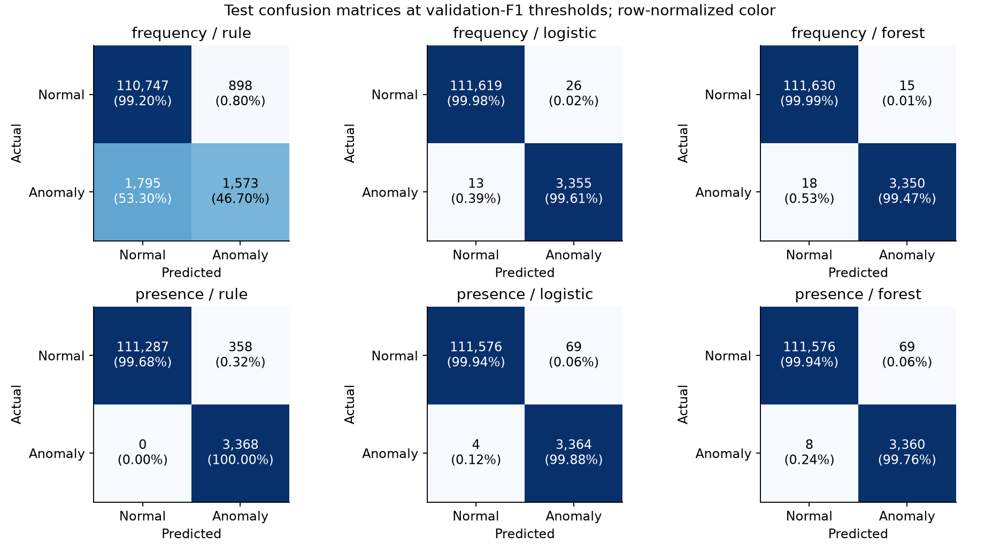

# Detecting Anomalous Events in Distributed System Logs Using Machine Learning: A Comparative Evaluation on HDFS_v1

Dezhang Li — Computer Science Research Portfolio  
Empirical research training project, 21 October 2026  
Status: completed local benchmark; researcher review pending; not a published paper.

## 1. Abstract

This study compares a normal-profile statistical rule, Logistic Regression and Random Forest for block-level anomaly detection in the official Loghub HDFS_v1 distribution. All 575,061 eligible blocks were linked to labels by identifier, with 16,838 anomalies (2.9280%). A fixed stratified split reserved 60% for training, 20% for validation and 20% for testing. Six configurations combined the three methods with event frequency or binary event presence. Thresholds were selected exclusively on validation data. At the F1-selected operating point, frequency-based Logistic Regression and Random Forest achieved test F1 scores of 0.9942 and 0.9951, respectively, compared with 0.5388 for the frequency rule. However, the presence rule achieved recall 1.0000 and FPR 0.003207, matching or exceeding learned-model recall under the validation FPR constraint. Extensive repeated vectors restrict interpretation: only 69 test blocks had frequency vectors absent from training. Results therefore demonstrate reproducible classification within a repetitive benchmark, not generalization to unseen failures, attacks or production systems.

## 2. Introduction

Distributed systems produce logs describing operations across components. For an analyst, the challenge is to convert these messages into a useful unit of observation and distinguish unusual but legitimate behavior from behavior labeled anomalous. Individual error words are insufficient: a message may be routine in one execution context and meaningful in another. This project examines that distinction through an accessible, reproducible comparison using existing public data rather than proposing a new detection algorithm.

The research questions are: **RQ1**, how do the rule, Logistic Regression and Random Forest differ in precision, recall and F1? **RQ2**, when validation false-positive rate is constrained to at most 1%, do machine learning models detect more anomalies? **RQ3**, does retaining event frequencies instead of only event presence change the results? The analysis unit is a Block ID and its event-count vector. References to anomalous events in the title therefore mean labeled block traces, not individually classified log lines.

The intended contribution is a transparent research implementation: verified data alignment, explicit feature exclusions, separated development and test roles, reproducible metric calculation, and candid assessment of benchmark weaknesses. Large sample counts alone cannot establish broad validity when many blocks share the same representation. Accordingly, the study emphasizes both achieved performance and the restricted population to which it applies.

## 3. Related Work

Xu et al. [1] grouped console messages by identifiers and represented groups using message counts. Their HDFS study used code inspection and expert consultation to label distinct count vectors; repeated vectors made manual validation feasible. Their observation that rare but normal activity can generate false alarms motivates inspecting errors rather than treating statistical rarity as an operational failure. The present work reuses the block-count idea but does not reproduce their PCA detector or claim identical data counts.

He et al. [2] evaluated six log anomaly detection methods, covering supervised and unsupervised approaches. Their comparative framework supports testing modest baselines before introducing complex models. Zhu et al. [3] describe Loghub as a public collection supporting reproducible log analytics. This study uses its archived HDFS_v1 files and retains the associated licence and provenance. Jiang et al. [4] investigate parser evaluation and introduce Loghub-2.0; their work highlights that upstream representation quality deserves scrutiny. Loghub-2.0 itself is not used here, and no parser accuracy is measured.

Landauer et al. [5] examine common log benchmarks and show why simple features can be highly effective when anomalies are not primarily sequential. Their HDFS discussion identifies repeated count vectors and limitations of preprocessed distributions. Le and Zhang [6] also find that data selection, grouping and class distributions can materially affect log detection evaluation. These studies motivate the duplicate-vector checks and narrow interpretation of this experiment; their published scores are not directly compared with ours because protocols and versions differ. Random Forest follows the ensemble family introduced by Breiman [7]. The implementation uses scikit-learn, while its metric documentation [8] distinguishes average precision from trapezoidal integration.

## 4. Data and Methods

### 4.1 Acquisition and content validation

The official Zenodo record 8196385 supplied `HDFS_v1.zip`, exactly 186,645,559 bytes. Its published MD5 was verified, and a local SHA-256 was recorded in the data manifest. The record version is v8, which is unrelated to the HDFS dataset name. Four preprocessed files were extracted after checking archive paths, sizes and entry types: `anomaly_label.csv`, `Event_occurrence_matrix.csv`, `Event_traces.csv` and `HDFS.npz`. The 1,577,982,906-byte raw log member remained compressed. Files were not executed, and originals were made read-only. The Loghub notice permits research or academic use subject to attribution and retaining the notice; raw data are excluded from the prospective repository.

The feature and label CSVs each contain 575,061 unique identifiers. An explicit one-to-one ID join found no missing, duplicate or unmatched IDs. All 29 event columns contain finite, nonnegative integers. The matrix's Success/Fail field agrees with the separate Normal/Anomaly labels. Every trace was independently converted to event counts and compared by ID, with zero mismatches. The matrix also contains `Type`, which encodes anomaly-related metadata; both it and `Label` are excluded, as is `BlockId`. Only E1–E29 enter the models. E22 is constant and retained consistently across configurations.

Inspection of the NPZ headers found object-valued event sequences and numeric labels without Block IDs. The object array was not unpickled, and neither array was joined to the CSVs. This avoids an unjustified row-order assumption. The supplied anomaly labels are benchmark annotations, not independently verified security incidents or attack labels. Counts from the original publication differ from this archive; local counts, rather than older literature totals, define the present denominators.

**Table 1. Actual block counts.**

| Split | Blocks | Normal | Anomaly | Anomaly % |
| --- | --- | --- | --- | --- |
| train | 345,036 | 334,933 | 10,103 | 2.9281 |
| validation | 115,012 | 111,645 | 3,367 | 2.9275 |
| test | 115,013 | 111,645 | 3,368 | 2.9284 |

### 4.2 Splitting and representations

After lexicographically sorting Block IDs, two stratified splits used seed 20261021 to obtain the allocation in Table 1. The split is complete and ID-disjoint. A preliminary 30,000-block pilot was drawn solely from the final training pool and internally split in the same proportions. It checked the pipeline without exposing the final validation or test labels to pilot development. The final run subsequently used every eligible block; no large-data sampling approximation was required.

Frequency features retain counts, while presence features replace each positive count with one. Logistic Regression applies `log1p` to frequencies and then a training-fitted StandardScaler; presence uses only training-fitted scaling. The rule and forest use counts or binary values directly. No feature selection, timestamp feature or sequence-order model is used. The official event vocabulary was created upstream across the distributed data, so this is not a demonstration of training-only log parsing.

Duplicate checks found 589 distinct frequency vectors and 119 distinct presence vectors. Nine frequency patterns and fifteen presence patterns have conflicting labels somewhere in the corpus. These diagnostics do not alter the predefined split or remove difficult cases. The preprocessed traces contain event tokens but no stable original-line identifiers; shared physical log lines across blocks were therefore not isolated. ID separation is verified, whereas raw-line independence is not.

### 4.3 Methods and operating points

The rule estimates each feature's mean and population standard deviation from normal training blocks only. Its anomaly score is the maximum absolute deviation from those means, divided by the larger of the corresponding standard deviation and one. The fixed scale floor prevents extreme amplification of nearly constant features. This simple marginal rule does not learn interactions or use anomalous training examples. It is deliberately limited and should not represent every possible rule-based detector.

Logistic Regression uses balanced class weights, C=1, the lbfgs solver and a maximum of 2,000 iterations. Random Forest uses 100 trees, maximum depth 12, minimum leaf size 5, square-root feature subsampling and balanced-subsample class weights. Both receive training labels, unlike the normal-only rule. Two worker threads bound computation. Settings were specified before fitting, without hyperparameter search; there was no post-test choice of representation or algorithm.

For each configuration, validation selects two score thresholds: maximum F1, and maximum recall subject to FPR at most 0.01. Score ties are treated together; objective ties prefer fewer false positives and then a higher threshold. An above-maximum threshold allows the no-alert solution if needed. All six threshold pairs are saved before final test scoring. The actual test FPR is subsequently reported without adjustment. Equal validation budgets do not imply equal realized test false-positive rates.

### 4.4 Evaluation and reproducibility

Anomaly is the positive class. Precision is TP/(TP+FP), recall is TP/(TP+FN), F1 is 2TP/(2TP+FP+FN), and FPR is FP/(FP+TN). Undefined precision or FPR is left blank. Trapezoidal PR-AUC is computed from the complete precision–recall curve, and average precision (AP) is separately reported because tied scores can produce different areas. Confusion counts account for every test block.

The implementation ran on macOS 27.0.1 arm64 with Python 3.13.2 and scikit-learn 1.9.1. Eleven unit tests cover keyed merging, rejected invalid inputs, feature exclusions, disjoint deterministic splitting, known metrics, threshold ties and normal-only fitting. A pilot warning revealed possible int8 overflow in a positive-support check; it was corrected before the final run and regression-tested. Rescoring the pilot confirmed unchanged observed metrics. A complete second final training run reproduced all reported metric values; forest score differences were at most machine precision. Saved prediction rescoring and CSV-driven figure regeneration also passed. This is a same-platform check, not cross-platform validation.

## 5. Results

### 5.1 Overall comparison and representation effects

**Table 2. Final test performance at validation-F1 thresholds; rates are fractions. PR-AUC is trapezoidal.**

| Features | Method | Precision | Recall | F1 | PR-AUC | AP | FPR |
| --- | --- | --- | --- | --- | --- | --- | --- |
| frequency | rule | 0.636584 | 0.467043 | 0.538791 | 0.227742 | 0.308318 | 0.008043 |
| frequency | logistic | 0.992310 | 0.996140 | 0.994221 | 0.998685 | 0.998699 | 0.000233 |
| frequency | forest | 0.995542 | 0.994656 | 0.995099 | 0.998335 | 0.998402 | 0.000134 |
| presence | rule | 0.903918 | 1.000000 | 0.949535 | 0.987566 | 0.978840 | 0.003207 |
| presence | logistic | 0.979901 | 0.998812 | 0.989266 | 0.997564 | 0.997290 | 0.000618 |
| presence | forest | 0.979878 | 0.997625 | 0.988671 | 0.992524 | 0.992367 | 0.000618 |

Frequency-based learned models markedly outperform the frequency rule on RQ1. Logistic Regression produces 3,355 TP, 26 FP and 13 FN; Random Forest produces 3,350 TP, 15 FP and 18 FN. The forest therefore has slightly higher F1 but lower recall. The difference is descriptive: one split with strongly repeated patterns cannot establish statistical superiority. The frequency rule instead produces 1,573 TP, 898 FP and 1,795 FN, showing that a large marginal deviation is a poor general substitute for the label relationships in these count vectors.

RQ3 does not have a uniform answer. Presence improves the rule's F1 from 0.5388 to 0.9495, while frequency yields better F1 for both learned models. Binary encoding removes magnitude variation that harms this particular rule, but also removes distinctions that the supervised classifiers can exploit. Presence-based Logistic Regression has 69 FP and four FN, whereas the presence forest has 69 FP and eight FN. The comparison concerns these fixed configurations and does not establish that one representation is always preferable.

### 5.2 Constrained false-positive operating points

**Table 3. Thresholds chosen on validation with FPR ≤1%; realized validation and test rates.**

| Features | Method | Validation FPR | Test FPR | Test recall | TP | FP | FN |
| --- | --- | --- | --- | --- | --- | --- | --- |
| frequency | rule | 0.008464 | 0.008043 | 0.467043 | 1573 | 898 | 1795 |
| frequency | logistic | 0.003619 | 0.003207 | 1.000000 | 3368 | 358 | 0 |
| frequency | forest | 0.003619 | 0.003207 | 0.999703 | 3367 | 358 | 1 |
| presence | rule | 0.003619 | 0.003207 | 1.000000 | 3368 | 358 | 0 |
| presence | logistic | 0.003619 | 0.003207 | 0.999703 | 3367 | 358 | 1 |
| presence | forest | 0.003619 | 0.003207 | 1.000000 | 3368 | 358 | 0 |

The frequency rule achieves only 0.4670 test recall under the constraint, while the learned frequency methods recover essentially all labeled anomalies. However, the presence rule already detects all 3,368 test anomalies with 358 FP, giving FPR 0.003207. No method can exceed its recall in this test set. Frequency Logistic Regression and the presence forest match that recall; frequency forest and presence Logistic Regression each miss one block. Thus RQ2 supports improvement over the frequency rule, not a universal recall advantage over simple methods.

All constrained validation thresholds satisfy the target, and all realized test FPR values remain below it. Most configurations use only about one third of the allowed false-positive budget because tied score groups and the recall-first objective do not require exhausting the budget. At the F1 operating point, the frequency forest reduces false positives to fifteen by accepting eighteen missed anomalies. The appropriate trade-off depends on the intended investigation cost, which this benchmark does not measure.

### 5.3 Observed error patterns

Errors are summarized reproducibly in `error_patterns.csv`, including the most frequent false-positive and false-negative patterns for each configuration. The frequency rule's largest false-positive pattern contains E4=15 and accounts for 293 test errors despite 883 normal training examples with the same vector. E4 describes an exception while serving a block in the archive's template listing. This illustrates why frequency rarity alone need not indicate the supplied anomaly label. Its largest missed pattern accounts for 596 anomalies and includes E20=1; the event concerns an unexpected deletion error. Its score, approximately 0.9996, is below the 2.9909 threshold. These are observations about representations and the rule, not independently established incident causes.

For presence features, pattern 21 has 886 normal and nine anomalous training examples. The rule flags this pattern, creating 248 test false positives; presence Logistic Regression rejects it at its F1 threshold and misses three anomalies. Pattern 60 has 117 normal and 313 anomalous training examples and contributes 37 false positives to both supervised presence methods. A deterministic classifier cannot distinguish differently labeled blocks that have identical inputs. These cases expose information lost by binarization and ambiguity in the chosen representation; they do not by themselves prove erroneous labels.

## 6. Discussion

The clearest finding is that representation and operating point matter as much as model family in this experiment. Learning label relationships provides a large gain over the specified frequency rule, but a presence-based rule already provides complete recall at a modest false-positive rate. The question is therefore not simply whether a more complex model wins. A meaningful comparison must state which information, threshold objective and error cost are being compared. The normal-only rule and supervised models also receive different training information, so their difference cannot isolate an effect of algorithm complexity alone.

The very high scores require substantial qualification. Of 115,013 test blocks, 114,944 share their frequency vector with training and 115,000 share their presence vector. Consequently, success is dominated by familiar patterns. A descriptive subset check leaves just 69 unseen-frequency blocks, comprising 56 anomalies and thirteen normal blocks. Frequency Logistic Regression has five FN and two FP there; frequency forest has four FN and four FP. Those tiny, atypical subsets cannot establish reliable unseen-pattern performance. The thirteen unseen-presence blocks are all anomalies, so their FPR is undefined. They are reported separately without treating their high PR scores as a balanced generalization test.

Block disjointness prevents literal ID reuse but does not guarantee independent executions. Shared raw lines were not reconstructed, upstream templates were reused, and the split is neither chronological nor grouped by physical incident. Label construction may be closely connected to the count features. These conditions can make random block evaluation optimistic for future systems. No confidence intervals treating all blocks as independent are presented, and no causal claim is made about why an operational failure occurred. A future study could group patterns and raw-line connections or evaluate another environment, but those experiments are outside this completed scope.

Class imbalance also changes interpretation. At 2.9280% anomaly prevalence, a small FPR can still create hundreds of alerts. Precision depends on this prevalence and would change in another workload even if recall and FPR remained stable. Trapezoidal PR-AUC and AP differ noticeably for the rule because score ties affect interpolation; both are retained to avoid concealing that choice. Neither ranking metric substitutes for explicit false-positive counts. No calibration, streaming latency, intervention benefit or production robustness has been demonstrated.

## 7. Conclusion

This project completed an executable comparison across all eligible HDFS_v1 preprocessed blocks, with keyed validation, separated pilot and final evaluation, genuine predictions, tested scoring and reproducible figures. Supervised frequency models achieved the highest F1, while the presence rule matched maximum constrained recall. The result supports careful baseline and representation selection rather than a blanket claim that machine learning always detects more anomalies. Extensive repeated patterns and unverified raw-line independence limit the finding to within-benchmark classification. The repository is suitable for discussing research methods and their limitations in a master's portfolio, subject to researcher review of the work and its attribution.

**AI assistance disclosure.** Codex assisted with source discovery, acquisition scripts, Python implementation, debugging, experiment execution, figures and drafting this report. Numerical claims come from actual saved runs. This document does not claim independent manual implementation by the student, completed personal scientific review, peer review or publication. Dezhang Li should inspect, understand and discuss the methods and limitations before presenting the work.

## 8. References

1. Xu, W., Huang, L., Fox, A., Patterson, D., & Jordan, M. I. (2009). *Detecting Large-Scale System Problems by Mining Console Logs*. SOSP. [Author full text](https://people.eecs.berkeley.edu/~jordan/papers/xu-etal-sosp09.pdf).
2. He, S., Zhu, J., He, P., & Lyu, M. R. (2016). *Experience Report: System Log Analysis for Anomaly Detection*. ISSRE, 207–218. DOI: 10.1109/ISSRE.2016.21. [Author full text](https://jiemingzhu.github.io/pub/slhe_issre2016.pdf).
3. Zhu, J., He, S., He, P., Liu, J., & Lyu, M. R. (2023). *Loghub: A Large Collection of System Log Datasets for AI-driven Log Analytics*. ISSRE. [Paper](https://arxiv.org/abs/2008.06448); [official data repository](https://github.com/logpai/loghub); [archived distribution](https://zenodo.org/records/8196385).
4. Jiang, Z., Liu, J., Huang, J., Li, Y., Huo, Y., Gu, J., Chen, Z., Zhu, J., & Lyu, M. R. (2024). *A Large-Scale Evaluation for Log Parsing Techniques: How Far Are We?* ISSTA. [Paper](https://arxiv.org/abs/2308.10828).
5. Landauer, M., Skopik, F., & Wurzenberger, M. (2023). *A Critical Review of Common Log Data Sets Used for Evaluation of Sequence-based Anomaly Detection Techniques*. arXiv preprint. [Full text](https://arxiv.org/pdf/2309.02854).
6. Le, V.-H., & Zhang, H. (2022). *Log-based Anomaly Detection with Deep Learning: How Far Are We?* [Author preprint](https://arxiv.org/abs/2202.04301).
7. Breiman, L. (2001). *Random Forests*. Machine Learning, 45, 5–32. [Author full text](https://www.stat.berkeley.edu/~breiman/randomforest2001.pdf).
8. scikit-learn developers. *average_precision_score* API documentation. Accessed 21 October 2026. [Definition and interpolation distinction](https://scikit-learn.org/stable/modules/generated/sklearn.metrics.average_precision_score.html).

Tables derive from `results/final-20261021/metrics.csv`, `validation_metrics.csv` and `sample_counts.csv`; figures are generated by `scripts/evaluate.py`. Unrounded values, confusion counts, thresholds, diagnostic subsets and execution provenance remain in the CSV/JSON files.
